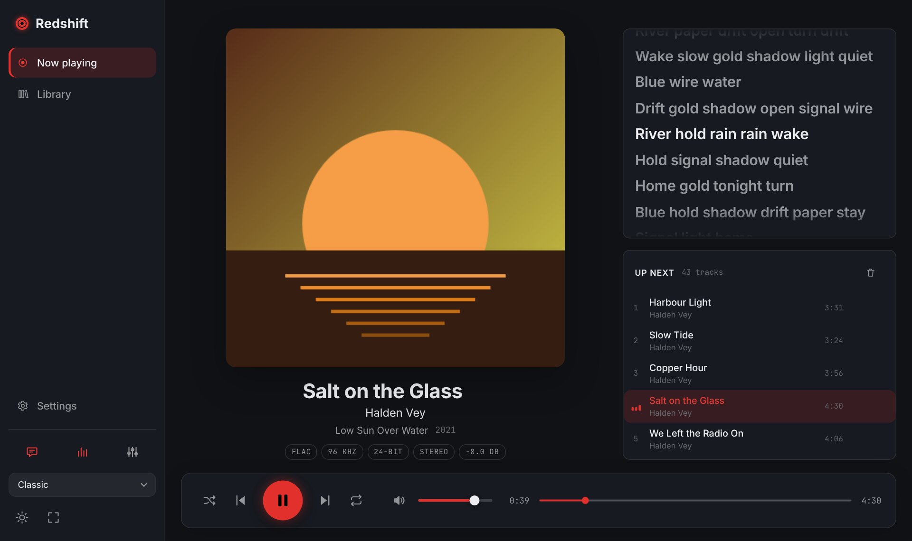
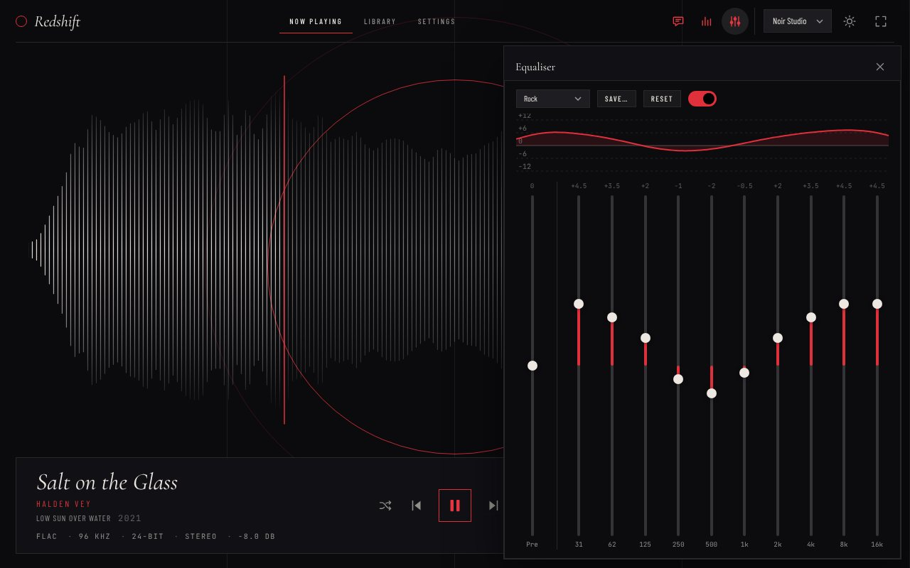
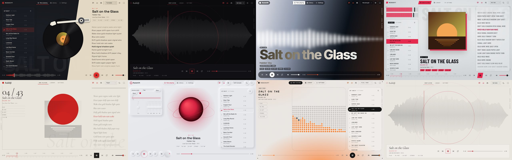
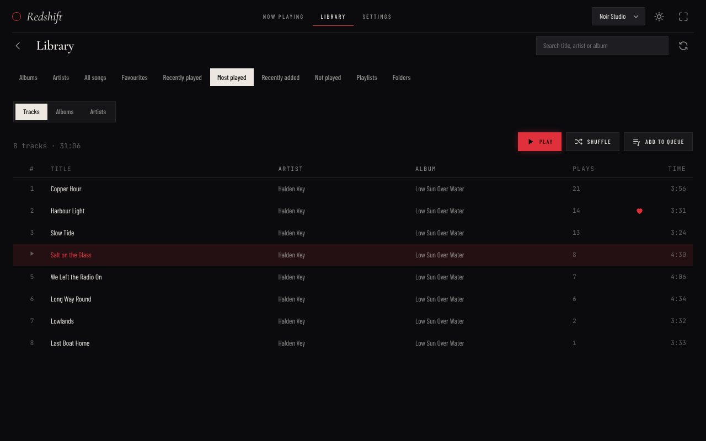
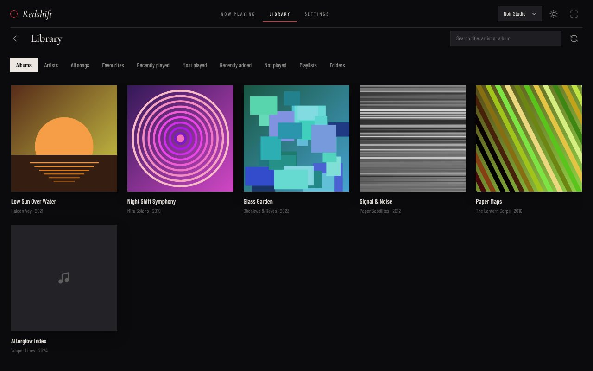
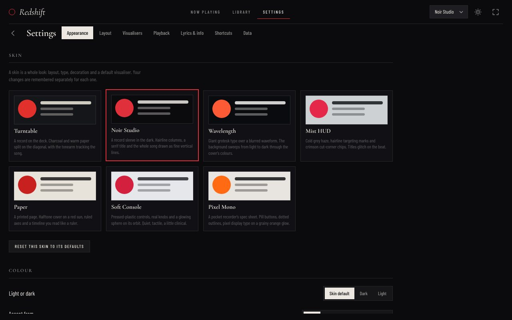

<h1 align="center">Redshift</h1>

<p align="center">
  A local music player for Windows with a cosmic streak: it plays your own FLAC and Opus files<br>
  through a built-in equaliser, shows synced lyrics, and looks the way you want it to.
</p>

<p align="center">
  
</p>

Redshift reads the music you already have. No account, no streaming, no tracking: point it at your folders and play. It's built with Tauri 2 and a Rust audio engine, so it starts quickly and stays light.

> The screenshots use invented demo albums and a stand-in player, so the artists and songs are made up.

## Download

Get the latest installer or the portable `.exe` from the [Releases page](https://github.com/mysticninja487/redshift/releases). It runs on Windows 10 and 11 (it uses WebView2, which is already part of both). Windows may show a "protected your PC" warning because the app isn't code-signed yet; choose "More info" then "Run anyway".

This is an early version. If something breaks, please [open an issue](https://github.com/mysticninja487/redshift/issues).

## What it does

**Plays your music properly**

- FLAC up to 24-bit / 192 kHz, Opus, MP3, Ogg Vorbis, WAV and AAC/M4A/ALAC.
- Gapless playback, or crossfade between tracks (0-12 s). Any sample rate is converted to what your sound device runs at.
- ReplayGain (track or album, with a pre-amp) and output device selection.

**Sounds the way you like**

<p align="center">
  
</p>

- A 10-band equaliser with a pre-amp, a live response curve, 24 built-in presets and your own saved presets. Open it from the top bar of Now Playing (or press `E`).

**Lyrics and visualisers**

- Synced lyrics from `.lrc` files next to the song or from the file's tags, with line and word timing.
- Twelve visualisers: bars, hairlines, oscilloscope, ring, wavelength blur, orb, particles, spectrogram, vectorscope, dot matrix, ridges and level meters. Lyrics, visualisers and the queue each switch off for every skin with one button, and Settings shows a live example of the lyrics as you change their size, fade and blur.

**Looks like you chose it**

<p align="center">
  
</p>

- Eight skins, each a whole composition rather than a colour set. Classic is the default: a sidebar, the cover and track in the middle, lyrics and the queue beside them, a player bar along the bottom. The others are Turntable, Noir Studio, Wavelength, Mist HUD, Paper, Soft Console and Pixel Mono. Switch from the skin menu, or with `[` and `]`. Options that only one skin has (the turntable's tonearm, Paper's halftone) show up under that skin's own heading in Settings.
- Light and dark, an accent from the skin, a preset, a custom colour, or colours taken from the current album art.
- Your own fonts for any skin: a built-in font, an installed font by name, or an imported font file. Text size, spacing, corner radius, line weight, shadows, frosted glass and grain are adjustable, and you can rearrange the panels.

**A library that knows your listening**

<p align="center">
  
</p>

- Albums, artists, all songs and a folder browser, with search. Play or shuffle any album, artist, folder or playlist, or double-click a track to play just that one.
- Favourites, recently played, most played (tracks, albums, artists), recently added and not played.
- Playlists with M3U/M3U8 import and export. Playlists made on another device are matched to your library by file name, folders and track title; anything that can't be found is kept, dimmed and skipped, and can be relinked later.
- Minimise to the system tray, with play/pause/next/previous in the tray menu.

**Fits into Windows**

- Media keys (play/pause, next, previous) and the track, cover and controls in the Windows volume flyout and lock screen.
- Open songs, folders or playlists with Redshift (right-click, "Open with", or drag them onto the exe or the window). A second launch hands its files to the player that's already running.
- A mini player: a small always-on-top window with the cover, the track, the current lyric line and the controls. Open it from the top bar or with `Ctrl+M`; double-click it to go back to the full player.

## Getting started

1. Install Redshift and open it.
2. Go to **Library > Folders**, choose **Add folder** and pick your music folder. It scans in the background and never changes your files.
3. Pick an album and press play.

| Key | Action | Key | Action |
| --- | --- | --- | --- |
| `Space` | Play / pause | `[` `]` | Previous / next skin |
| `Shift` + `←` `→` | Previous / next track | `V` | Next visualiser |
| `←` `→` | Seek 5 s | `Shift` + `V` | Visualisers on / off |
| `↑` `↓` | Volume | `L` | Lyrics on / off |
| `S` `R` `M` | Shuffle, repeat, mute | `E` | Equaliser |
| `1` `2` `3` | Now playing, Library, Settings | `D` | Light / dark |
| `Ctrl` + `F` | Search the library | `F` | Fullscreen |

Every shortcut can be changed in Settings.

<p align="center">
  
  
</p>

---

# For developers

Redshift is a Rust workspace with a plain-JavaScript front end (no bundler). To build it from source you need Rust 1.85+ with the MSVC toolchain, CMake (libopus is compiled from source), and the Tauri CLI (`cargo install tauri-cli --version "^2"`). Then `cargo tauri dev` runs it and `cargo tauri build` makes an installer. If the build stops in `audiopus_sys` with a CMake error, set `CMAKE_POLICY_VERSION_MINIMUM=3.5`. Releases are built by the "Windows build" GitHub Actions workflow when a `v*` tag is pushed.

The icons in `src-tauri/icons` are placeholders; replace them with `cargo tauri icon your-logo.png`.

## Layout

```
crates/redshift-core/   All the logic. No GUI dependencies; `cargo test` runs here.
  decode/             FLAC/MP3/Vorbis/WAV/AAC via symphonia; Opus via libopus
  dsp/                EQ, resampler, spectrum analyser
  engine/             Real-time mixer, decoder-fed sources, output, player thread
  queue.rs  library.rs  playlists.rs  lyrics.rs  meta.rs
  resolve.rs  stats.rs  fonts.rs   Playlist matching, play history and favourites, imported fonts
  app.rs              Owns the player, library, playlists and settings
src-tauri/            Thin Tauri shell: one command per `App` method, plus events
ui/                   Front end: plain ES modules, no bundler (see "The interface")
scripts/              Generates the audio fixtures the tests use
```

## Tests

```
cargo test            # the audio core; needs no GUI libraries
cargo check -p redshift # type-check the Tauri shell (needs webkit2gtk on Linux, WebView2 on Windows)
```

The test audio is generated by `scripts/gen_fixtures.sh` (needs ffmpeg) and committed. Most fixtures are "chirps" whose frequency rises with time, so a test can tell *where in the song* any piece of output came from by measuring its pitch. That is how seeking, gapless joins and crossfades are checked without listening to anything.

## Talking to the engine from the UI

Commands are called with `window.__TAURI__.core.invoke('name', { argName: value })`. Rust's `snake_case` arguments are `camelCase` in JavaScript (`preamp_db` becomes `preampDb`).

| Area | Commands |
| --- | --- |
| Playback | `set_queue`, `play_entry`, `pause`, `resume`, `toggle_pause`, `stop`, `next`, `previous`, `seek` |
| Queue | `queue_append`, `queue_play_next`, `queue_remove`, `queue_move`, `queue_clear`, `queue_view` |
| State (poll) | `player_state` (position, volume, status...), `viz_frame` (at the display's frame rate) |
| Sound | `set_volume`, `set_muted`, `set_shuffle`, `set_repeat`, `set_crossfade_secs`, `set_replaygain`, `output_devices`, `set_output_device` |
| Equalizer | `eq_info`, `set_eq_enabled`, `set_eq_preamp_db`, `set_eq_band_db`, `set_eq_gains_db`, `apply_eq_preset`, `save_eq_preset`, `delete_eq_preset`, `eq_curve` |
| Visualiser | `configure_viz` |
| Library | `library_folders`, `add_library_folder`, `remove_library_folder`, `scan_library`, `is_scanning`, `library_tracks`, `search_library`, `library_albums`, `library_artists`, `recently_added`, `track_meta` |
| Lyrics | `lyrics` |
| Playlists | `playlists`, `playlist`, `create_playlist`, `rename_playlist`, `delete_playlist`, `move_playlist`, `add_to_playlist`, `remove_from_playlist`, `move_in_playlist`, `import_m3u`, `relink_playlist`, `paths_exist`, `export_m3u`, `play_playlist` |
| Favourites and history | `favourite_paths`, `favourites`, `set_favourite`, `play_stats`, `reset_play_stats` |
| Fonts and window | `fonts`, `import_font`, `remove_font`, `set_tray` |
| Settings | `get_settings`, `ui_state`, `set_ui_state` |

Events: `player-event` (track changed, queue changed, ended, error, device changed) and `scan-progress`.

Cover art is an image URL: `cover://localhost/` followed by `encodeURIComponent(path to the audio file)`; on Windows the host is `http://cover.localhost/`.

Folder and file pickers come from the dialog plugin: `window.__TAURI__.dialog.open({ directory: true })`.

## The interface

Eight skins, switchable from the skin menu or with `[` and `]`. A skin is a whole composition (grid, type, decoration, default hero and visualiser), not just a colour set. Each one remembers its own settings.

| Skin | Look |
| --- | --- |
| Turntable | Charcoal with a paper panel cut on the diagonal; a spinning record with a tonearm that tracks the song |
| Noir Studio | Serif title, hairline columns, the whole song drawn as vertical lines around a red playhead |
| Wavelength | Giant grotesk title multiplied over a blurred waveform on a light-to-dark sweep |
| Mist HUD | Grey haze, targeting marks, cut-corner chips, ruler seek bar, glitch on the beat |
| Paper | Halftone cover over a red sun, ruled axes, big light numerals |
| Soft Console | Pressed-plastic surfaces, real knobs, a glowing orb |
| Pixel Mono | Pill buttons, dotted outlines, pixel type, dot-matrix visualiser |

Everything is customisable in Settings (the gear button, or `Ctrl` `,`): light/dark, accent from the skin, a preset, a custom colour or the current album art; fonts, text size, spacing, corner radius, line weight, shadows, frosted glass, film grain; where each panel sits (or hide it) and the column sizes; twelve visualisers, each with its own options, for the centrepiece and for a separate panel; progress-bar style; lyrics size, alignment and fade; remappable keyboard shortcuts; export and import of a skin's settings.

Visualisers: bars, hairlines, oscilloscope, ring, wavelength blur, orb, particles, spectrogram, vectorscope, dot matrix, ridges, level meters.

Source layout: `ui/js/skins.js` (skin definitions), `theme.js` (colours and album-art palette), `prefs.js` (per-skin settings), `panels/` (the panels), `viz/` (visualisers), `views/` (Library, Settings), `css/skins/<id>.css` (one file per skin). All backend calls go through `ui/js/api.js`.

### Previewing without Windows

```
cd ui && python3 -m http.server 8000
```

Open <http://localhost:8000>. With no Tauri around, the app loads `ui/dev/mock.js`: invented albums with generated covers, a player that keeps time, synthetic spectrum frames, lyrics and playlists. Nothing is audible. Add `?empty` for an empty library or `?paused` to start paused.

## Not done yet

- Wider testing on real Windows machines and sound hardware. The engine's tests use a simulated sound card, so device-specific bugs are likely to turn up.
- Restoring the queue and position after a restart.
- Opus files with more than two channels (they're reported as unsupported).
- Watching library folders for changes (rescan is manual).

## Licence

MIT
