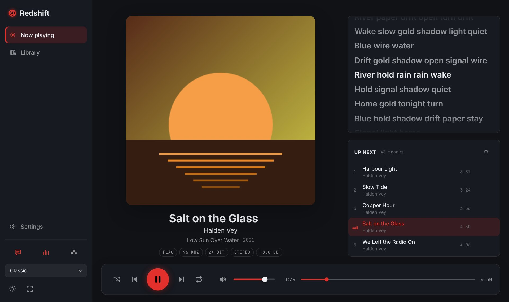
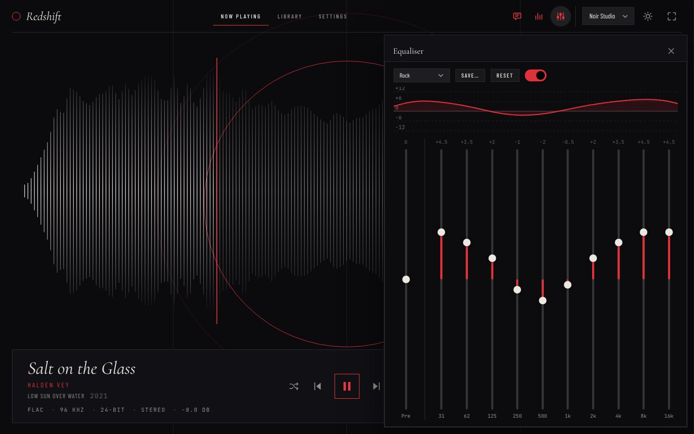
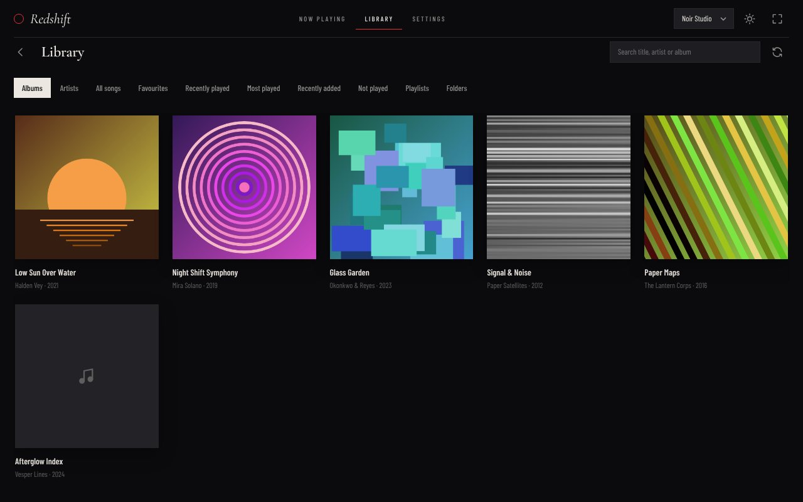
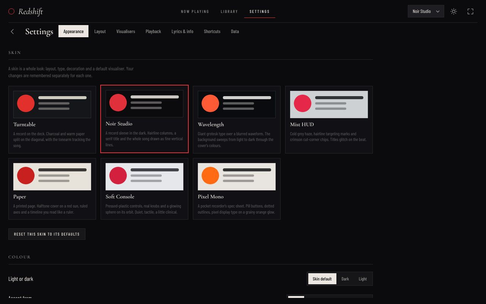

<h1 align="center">Redshift</h1>

<p align="center">
  A Windows music player for the files you already own.<br>
  FLAC, Opus and more, gapless, with an equaliser, word-by-word lyrics and skins you can remake.
</p>

<p align="center">
  
</p>

Point Redshift at your music folders and play. There is no account, no streaming and no tracking, and it never changes your files unless you edit a tag yourself. It is built with Tauri 2 and a Rust audio engine, so it starts fast and idles at close to nothing.

Everything that touches the internet (lyrics lookup, update check) is **off until you switch it on** in Settings > Online, which also shows every request that was made.

> The screenshots use invented demo albums and a stand-in player, so the artists and songs are made up.

## Download

Get the installer or the portable `.exe` from the [Releases page](https://github.com/mysticninja487/redshift/releases). Windows 10 and 11 are supported (it uses WebView2, which both include). The installer adds Redshift to "Open with" for audio files and playlists. Windows may warn that it "protected your PC" because the app is not code-signed yet: choose **More info**, then **Run anyway**.

This is early software. If something breaks, please [open an issue](https://github.com/mysticninja487/redshift/issues).

## Getting started

1. Open Redshift, go to **Library > Folders** and choose **Add folder**.
2. Pick your music folder. It is scanned in the background and watched afterwards, so new songs appear within about a minute.
3. Pick an album and press play.

| Key | Action | Key | Action |
| --- | --- | --- | --- |
| `Space` | Play / pause | `1` `2` `3` `4` | Now playing, Library, Settings, Stats |
| `←` `→` | Seek 5 s | `Shift` + `←` `→` | Previous / next track |
| `↑` `↓` | Volume | `S` `R` `M` | Shuffle, repeat, mute |
| `L` | Lyrics on / off | `E` | Equaliser |
| `V` / `Shift` + `V` | Next visualiser / visualisers on or off | `[` `]` | Previous / next skin |
| `<` `>` | Slower / faster | `D` | Light / dark |
| `T` | Edit tags of the playing song | `I` | Info on the playing song |
| `A` | Ambient mode | `Ctrl` + `M` | Mini player |
| `Ctrl` + `F` | Search the library | `F1` | Help & about |

Every shortcut can be changed in Settings > Shortcuts.

## What it does

### Playback

- FLAC up to 24-bit / 192 kHz, Opus, MP3, Ogg Vorbis, WAV and AAC / M4A / ALAC. Any sample rate is converted to what your sound device runs at.
- **Gapless** for every format (encoder padding is cut from MP3, Vorbis and M4A), or a **crossfade** of 0–12 s.
- ReplayGain (track or album, with a pre-amp) and output device selection.
- **Speed and pitch**: 0.5×–2× and ±12 semitones, either time-stretched (the key stays) or tape style (pitch follows speed).
- A 10-band **equaliser** with a pre-amp, a live curve, 24 presets and your own.
- A **sleep timer** that fades the volume out, and queue options (no duplicates, keep shuffle, shuffle the whole queue).
- Redshift resumes where you left off: the queue, the song and the position.

<p align="center">
  
</p>

### Lyrics

- Synced lyrics from a `.lrc` file next to the song or from its tags, with line and word timing. Lyrics can be shown beside the cover, over a visualiser, or full screen.
- **Online lyrics** (optional) from [BetterLyrics](https://better-lyrics.boidu.dev) by boidushya, which times every word, and from [LRCLIB](https://lrclib.net) for songs BetterLyrics does not have. Found lyrics are shown straight away and kept only if you choose: **Save to tags** writes them into the song, **Save as .lrc** puts a file next to it (with word timing when there is some).
- A song that already has lyrics of its own gets a **Built-in | Online** switch above them; Redshift remembers which you prefer.
- The **tag editor** adds or changes lyrics, plain or timed, and **Sync lyrics** lets you time a song by pressing `Space` as each line starts.

### Your library

- Albums, artists, all songs and a folder browser, with search. Favourites, recently played, most played, recently added and not played.
- Playlists with M3U / M3U8 import and export; playlists from another device are matched to your library by name and folder, and anything missing is kept and can be relinked later.
- **Tag editor** (`T`, or right-click a song, album or artist > Edit tags…): title, artist, album, genre, year, track and disc numbers, comment, cover art and lyrics, for one song or a whole album at once. Only the fields you touch are written, to a copy that replaces the original once it is complete.
- **Song info** (`I`): tags, format, bitrate, sample rate, ReplayGain, play history and where the file is.

<p align="center">
  
</p>

### Stats and mixes

- Listening time for today, this week, month and year, each compared with the stretch before; your top song, artist and album; your taste (genres, time of day, how much was new, which era); and a listening streak.
- **Mixes for you**, made from your listening and refreshed daily: On repeat, Take me back, a mix per top genre and artist, Fresh picks and favourites. Play, queue or save any as a playlist.
- **Play story**: a short slideshow of your day, week, month or year.
- A song counts as played after a share of its length you choose (1–100%, 50% by default); skipped songs do not count.
- Everything is counted on your computer and never sent anywhere. **Settings > General > Reset play counts** empties Most played, Recently played and Not played; the Stats screen has its own **Reset listening history**, which asks twice.

### Looks

<p align="center">
  
</p>

- **Eight skins**, each a whole composition rather than a colour set: Classic, Turntable, Noir Studio, Wavelength, Mist HUD, Paper, Soft Console and Pixel Mono. Switch with `[` and `]`; each skin remembers its own settings.
- Light and dark; an accent from the skin, a preset, your own colour or the current album art. Fonts (built-in, installed or imported), text size, spacing, corner radius, shadows, frosted glass and grain. Panels can be moved or hidden.
- **Your own skins**: tune a skin, then Settings > Appearance > Save this look as a new skin. Export one to a small `.json` file to share, or import one.
- **Twelve visualisers**, each with its own options: bars, hairlines, oscilloscope, ring, wavelength blur, orb, particles, spectrogram, vectorscope, dot matrix, ridges and level meters.
- **Ambient mode** (`A`) turns the window into a full-screen visualiser, lyrics, or both, and keeps the screen awake.
- Settings shows a live preview of what you change, marks rows that differ from the default, and **Hold to compare** shows everything at its defaults for as long as you hold it. **Settings > Appearance > Reset all appearance settings** returns every skin to its defaults.
- Seven interface languages: English, Bengali, Spanish, French, German, Japanese and Simplified Chinese, or follow Windows. Song titles, artists, genres, lyrics and playlist names are never translated.

### Part of Windows

- Media keys and the track, cover and controls in the volume flyout and on the lock screen.
- A **mini player**: a compact always-on-top strip that expands into a card with the queue or lyrics.
- A system tray icon with play / pause / next / previous, optional song notifications, and launch on startup.
- Open songs, folders and playlists with Redshift from Explorer or by dragging them on; a second launch hands its files to the running player.

### Online features (optional, off by default)

Settings > Online has a main switch. Nothing goes over the network until it is on, and each feature says exactly what it sends.

| Feature | Host | What is sent |
| --- | --- | --- |
| Lyrics (BetterLyrics) | `api.betterlyrics.org` | Song title, artist, album and length in seconds |
| Lyrics (LRCLIB) | `lrclib.net` | The same |
| Update check | `api.github.com` | Nothing about you or your music; it only asks for the latest release and never downloads anything |

Any request also carries your IP address and the app's name and version, as with any website. You can choose which lyrics service to use (Automatic asks BetterLyrics first, then LRCLIB). BetterLyrics only answers for songs it already has, so it often has nothing and Automatic falls back to LRCLIB. The page keeps a log of recent requests and a button to clear it and the saved answers.

All of it goes through one network layer in the core: HTTPS only, a short list of allowed hosts, redirects checked against that list, short timeouts, size limits and a local cache. It trusts the Windows certificate store.

## Performance

Redshift stops animating when nothing is moving. A paused player redraws almost nothing; when the window is minimised or in the tray, the page stops drawing and its web view is suspended while the music plays on. Cover art in lists is served as small copies. **Settings > Visualisers > Performance > Reduce effects** drops blur, blend modes and grain and caps the visualiser at 30 fps for older hardware or laptops on battery.

<p align="center">
  
  
</p>

---

# For developers

Redshift is a Rust workspace with a plain JavaScript front end and no bundler. To build it you need Rust 1.85+ with the MSVC toolchain, CMake (libopus is compiled from source) and the Tauri CLI (`cargo install tauri-cli --version "^2"`). Then `cargo tauri dev` runs it and `cargo tauri build` makes an installer. If the build stops in `audiopus_sys` with a CMake error, set `CMAKE_POLICY_VERSION_MINIMUM=3.5`. The "Windows build" GitHub Actions workflow builds a release when a `v*` tag is pushed. The icons in `src-tauri/icons` are placeholders; replace them with `cargo tauri icon your-logo.png`.

## Layout

```
crates/redshift-core/    All the logic, with no GUI dependencies. `cargo test -p redshift-core` runs here.
  decode/                FLAC / MP3 / Vorbis / WAV / AAC via symphonia, Opus via libopus, M4A gapless
  dsp/                   Equaliser, resampler, time-stretch, spectrum analyser
  engine/                Real-time mixer, decoder-fed sources, output device, player thread
  net/                   The network layer and its providers: betterlyrics, lrclib, updates
  app.rs                 Owns the player, library, playlists and settings
  library.rs  playlists.rs  queue.rs  lyrics.rs  tags.rs  meta.rs  resolve.rs
  history.rs  stats.rs  insights.rs  waveform.rs  thumb.rs  fonts.rs
src-tauri/               A thin Tauri shell: one command per App method, plus events
ui/                      The front end: plain ES modules (see below)
scripts/                 Generates the audio fixtures the tests use
```

## Tests

```
cargo test -p redshift-core   # the core; needs no GUI libraries
cargo check -p redshift       # type-checks the Tauri shell (needs WebView2 on Windows or webkit2gtk on Linux)
```

Test audio is generated by `scripts/gen_fixtures.sh` (needs ffmpeg) and committed. Most fixtures are chirps whose pitch rises with time, so a test can tell where in the song any piece of output came from. That is how seeking, gapless joins and crossfades are checked without listening. The network layer is tested against a small local HTTP server, so no test touches the internet.

## Talking to the engine

The UI calls `window.__TAURI__.core.invoke('command_name', { argName: value })`; Rust's `snake_case` arguments are `camelCase` in JavaScript. Every command is registered in `src-tauri/src/main.rs` and wrapped by one function in `ui/js/api.js`, which is the only place the UI calls the backend. Events are `player-event` (track changed, queue changed, ended, error, device changed) and `scan-progress`. Cover art is an image URL, `cover://localhost/` plus `encodeURIComponent(path to the audio file)` (on Windows `http://cover.localhost/`).

## The interface

`ui/js/skins.js` defines the skins, `theme.js` the colours and album-art palette, `prefs.js` the per-skin settings, `panels/` the panels, `viz/` the visualisers, `views/` the Library, Settings and Stats screens, and `css/skins/<id>.css` one file per skin. Translations are `ui/js/i18n/<language>.js`, plain lists of English text and its translation, so a phrase or a language is a one-file change.

### Previewing without Windows

```
cd ui && python3 -m http.server 8000
```

Open <http://localhost:8000>. With no Tauri around the app loads `ui/dev/mock.js`: invented albums with generated covers, a player that keeps time, synthetic spectrum frames, lyrics, playlists and a pretend network. Nothing is audible. Add `?empty` for an empty library or `?paused` to start paused.

## Adding an online feature

Every online feature goes through `redshift-core::net`: add the provider as a module in `net/`, add its host to the allowed list where `App::new` creates the client, say what it sends in Settings > Online, and test it against the local test server in `net/mod.rs`. Nothing should open its own connection.

## Not done yet

- Testing on more real Windows machines and sound hardware. The engine's tests use a simulated sound card, so device-specific bugs are likely.
- Opus files with more than two channels (reported as unsupported).
- Importing playlists from streaming services, Discord rich presence and automatic updates. See the roadmap.

## Licence

MIT.
