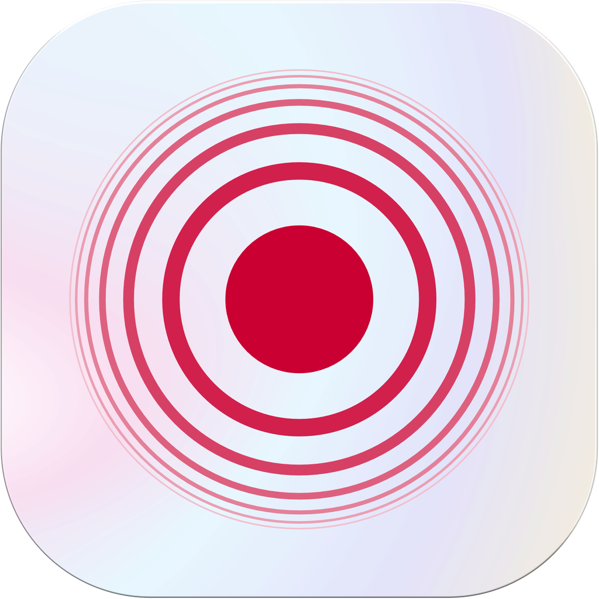
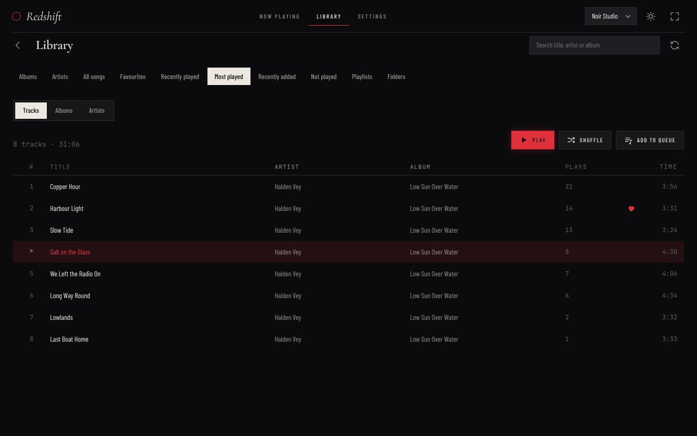
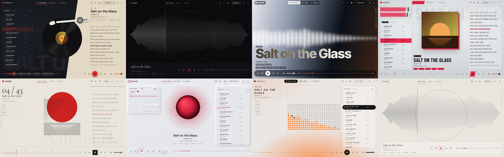

<p align="center">
  
</p>

<h1 align="center">Redshift</h1>

<p align="center">
  A Windows music player for the files you already own.<br>
  FLAC, Opus and more, gapless, with an equaliser, word-by-word lyrics and skins you can remake.
</p>

<p align="center">
  
</p>

Point Redshift at your music folders and play. There is no account and no tracking, and it never changes your files unless you edit a tag yourself. It is built with Tauri 2 and a Rust audio engine, so it starts fast and idles at close to nothing.

Everything that touches the internet (lyrics lookup, update check, internet radio, your own music server) is **off until you switch it on** in Settings > Online, which also shows every request that was made.

> The screenshots use invented demo albums and a stand-in player, so the artists and songs are made up.

## Download

Get the installer or the portable `.exe` from the [Releases page](https://github.com/mysticninja487/redshift/releases). Windows 10 and 11 are supported (it uses WebView2, which both include). The installer adds Redshift to "Open with" for audio files and playlists. Windows may warn that it "protected your PC" because the app is not code-signed yet: choose **More info**, then **Run anyway**.

This is early software. If something breaks, please [open an issue](https://github.com/mysticninja487/redshift/issues).

## Getting started

1. Open Redshift, go to **Library > Folders** and choose **Add folder**.
2. Pick your music folder. It is scanned in the background and watched afterwards, so new songs appear within about a minute.
3. Pick an album and press play.

| Key | Action | Key | Action |
| --- | --- | --- | --- |
| `Space` | Play / pause | `1` `2` `3` `4` | Now playing, Library, Settings, Stats |
| `←` `→` | Seek 5 s | `Shift` + `←` `→` | Previous / next track |
| `↑` `↓` | Volume | `S` `R` `M` | Shuffle, repeat, mute |
| `L` | Lyrics on / off | `E` | Equaliser |
| `V` / `Shift` + `V` | Next visualiser / visualisers on or off | `[` `]` | Previous / next skin |
| `<` `>` | Slower / faster | `D` | Light / dark |
| `T` | Edit tags of the playing song | `I` | Info on the playing song |
| `A` | Ambient mode | `Ctrl` + `M` | Mini player |
| `Ctrl` + `F` | Search the library | `F1` | Help & about |

Every shortcut can be changed in Settings > Shortcuts.

## What it does

### Playback

- FLAC up to 24-bit / 192 kHz, Opus, MP3, Ogg Vorbis, WAV and AAC / M4A / ALAC.
- **Exclusive mode** (Settings > Playback > Output, Windows): Redshift takes the sound device for itself and opens it at each song's own sample rate and bit depth, so nothing is mixed in or resampled. If the device refuses, Redshift plays the usual way and says why. Without it, a song's rate is converted to what Windows runs the device at.
- **Bit-perfect mode** switches off the equaliser, ReplayGain, speed, pitch and crossfade. Now Playing shows a **Bit-perfect** tag when the file's own samples reach the device untouched (exclusive output, the song's own rate, no processing, volume at 100%), and Song info shows the whole signal path, including what changes it when it isn't.
- **Gapless** for every format (encoder padding is cut from MP3, Vorbis and M4A), or a **crossfade** of 0–12 s.
- ReplayGain (track or album, with a pre-amp) and output device selection.
- **Speed and pitch**: 0.5×–2× and ±12 semitones, either time-stretched (the key stays) or tape style (pitch follows speed).
- A 10-band **equaliser** with a pre-amp, a live curve, 24 presets and your own.
- A **sleep timer** that fades the volume out, and queue options (no duplicates, keep shuffle, shuffle the whole queue).
- Redshift resumes where you left off: the queue, the song and the position.

<p align="center">
  
</p>

### Lyrics

- Synced lyrics from a `.lrc` file next to the song or from its tags, with line and word timing. Lyrics can be shown beside the cover, over a visualiser, or full screen.
- **Online lyrics** (optional) from [BetterLyrics](https://better-lyrics.boidu.dev) by boidushya, which times every word, and from [LRCLIB](https://lrclib.net) for songs BetterLyrics does not have. Found lyrics are shown straight away and kept only if you choose: **Save to tags** writes them into the song, **Save as .lrc** puts a file next to it (with word timing when there is some).
- The lyrics panel has a switch above the lyrics: **Embedded | BetterLyrics | LRCLIB**. Embedded is whatever the song carries in its tags or a `.lrc` file; the other two look the song up there (and say "Word by word", "Line by line" or "Not timed"). Redshift remembers which you prefer, and a service that has nothing for the song is greyed out.
- **Find lyrics online…** in the right-click menu of a song, album, artist or selection looks up every song that has no lyrics, one after another, and saves each next to the song, in its tags, or both. Songs that already have lyrics are left alone.
- The **tag editor** adds or changes lyrics, plain or timed, and **Sync lyrics** lets you time a song by pressing `Space` as each line starts, or, with **Words**, as each word starts. Word timing is kept in a `.lrc` file; the tags take line timing, since most players cannot read word stamps there.

### Your library

- Albums, artists, all songs and a folder browser, with search. Favourites, recently played, most played, recently added and not played.
- Import a public Deezer, Spotify or YouTube playlist from its link, or a pasted list of songs (`Artist - Title` per line, or a Spotify CSV export such as Exportify's): songs are matched to your files by title, artist and length, the ones you don't have are listed and can be copied, and the playlist is made from the ones you do. Deezer is read from its open API (any length); Spotify has no open API for this, so its public embed page is read, which shows the first 100 songs and can break if Spotify changes it. YouTube is read through the same data call its own web page uses (any length), falling back to the page itself. When a service changes its format the import says so, and the pasted-list route still works.
- Playlists with M3U / M3U8 import and export; playlists from another device are matched to your library by name and folder, and anything missing is kept and can be relinked later.
- **Tag editor** (`T`, or right-click a song, album or artist > Edit tags…): title, artist, album, genre, year, track and disc numbers, comment, cover art and lyrics, for one song or a whole album at once. Only the fields you touch are written, to a copy that replaces the original once it is complete.
- **Song info** (`I`): tags, format, bitrate, sample rate, ReplayGain, play history and where the file is.

<p align="center">
  
</p>

### Stats and mixes

- Listening time for today, this week, month and year, each compared with the stretch before; your top song, artist and album; your taste (genres, time of day, how much was new, which era); and a listening streak.
- **Mixes for you**, made from your listening and refreshed daily: On repeat, Take me back, a mix per top genre and artist, Fresh picks and favourites. Play, queue or save any as a playlist.
- **Play story**: a short slideshow of your day, week, month or year.
- A song counts as played after a share of its length you choose (1–100%, 50% by default); skipped songs do not count.
- Everything is counted on your computer and never sent anywhere. **Settings > General > Reset play counts** empties Most played, Recently played and Not played; the Stats screen has its own **Reset listening history**, which asks twice.

### Looks

<p align="center">
  
</p>

- **Eight skins**, each a whole composition rather than a colour set: Classic, Turntable, Noir Studio, Wavelength, Mist HUD, Paper, Soft Console and Pixel Mono. Switch with `[` and `]`; each skin remembers its own settings.
- Light and dark; an accent from the skin, a preset, your own colour or the current album art. Fonts (built-in, installed or imported), text size, spacing, corner radius, shadows, frosted glass and grain. Panels can be moved or hidden.
- **Your own skins**: tune a skin, then Settings > Appearance > Save this look as a new skin. Export one to a small `.json` file to share, or import one.
- **Twelve visualisers**, each with its own options: bars, hairlines, oscilloscope, ring, wavelength blur, orb, particles, spectrogram, vectorscope, dot matrix, ridges and level meters.
- **Ambient mode** (`A`) turns the window into a full-screen visualiser, lyrics, or both, and keeps the screen awake.
- Settings shows a live preview of what you change, marks rows that differ from the default, and **Hold to compare** shows everything at its defaults for as long as you hold it. **Settings > Appearance > Reset all appearance settings** returns every skin to its defaults.
- Seven interface languages: English, Bengali, Spanish, French, German, Japanese and Simplified Chinese, or follow Windows. Song titles, artists, genres, lyrics and playlist names are never translated.

### Part of Windows

- Media keys and the track, cover and controls in the volume flyout and on the lock screen.
- A **mini player**: a compact always-on-top strip that expands into a card with the queue or lyrics.
- A system tray icon with play / pause / next / previous, optional song notifications, and launch on startup.
- Open songs, folders and playlists with Redshift from Explorer or by dragging them on; a second launch hands its files to the running player.

### Discord rich presence (optional, off by default)

Settings > Discord puts "Listening to" and the song on your Discord profile while music plays. It is shaped like the Discord tab in Limusic, with a live preview of the card:

- **Status text**: what Discord writes after "Listening to" (the app name, line 1 or line 2), and an **app name** to show instead of "Redshift".
- **Card**: line 1 and line 2 (title, artist, album or artist - album), line 3 (under line 2 and on hover), the album art, a small Redshift badge, and a progress bar.
- **Links and buttons**: line 1, line 2 and the album art can open a search for what they show, on YouTube Music, Spotify, Apple Music, YouTube or Last.fm; two buttons (listen, album, artist or "Get Redshift"). Redshift plays your own files, so these are searches, not links to the exact song. Other people see the buttons; you do not see them on your own profile.
- **Show while paused** (without the progress bar) and **Hide details** (only "Listening to music").

Redshift talks to the Discord app on the same computer (through its local pipe); Discord shows the card to other people. Updates are spaced to stay within Discord's limits. The only online part is the album cover: with Go online on, Redshift asks `itunes.apple.com` for the cover of the song (artist and title, once per song); without it, the Redshift logo is shown.

It needs a Discord application ID. The release has one built in; otherwise paste your own under Advanced (create an application at discord.com/developers, name it Redshift, and upload `assets/brand/redshift-icon.png` as an image called `redshift` under Rich Presence assets).

### Internet radio (optional, off by default)

Press **5** for Radio. Stations come from the free [radio-browser.info](https://www.radio-browser.info) directory; you can search by name or genre, keep favourites, or paste any station address and press **Play address**. Lossless (FLAC) stations are marked and listed first by default, everything else is labelled **Lossy**, and plain `http` stations say **Not encrypted**. Now Playing shows **LIVE** instead of a length, the song the station announces (ICY or Ogg/Opus tags) and the stream's codec and bitrate, and the signal path says what happens to it like it does for a file. Streams can't be sought, and they are not counted in Stats or history. MP3, AAC (ADTS), Ogg Vorbis, Opus and FLAC streams play and reconnect on their own after a drop; HLS and HE-AAC stations are not supported yet, and a stream that follows a song starts with a short gap because it can't be preloaded.

### Your own server (Navidrome, Subsonic; optional, off by default)

Press **6** for Server. Add the address, user name and password of your [Navidrome](https://www.navidrome.org) (or any Subsonic-compatible server) in Settings > Online > Your own server and press **Save and test connection**. Then browse its albums (recently added, recently played, most played, random, A to Z, starred), artists and playlists, or search it, and play. Songs play as their **original files** (no transcoding), fetched in pieces, so a lossless library stays lossless, seeking jumps straight to the right place without downloading the whole file, and the next song is prepared for gapless playback. Each song is marked **Lossless** or **Lossy**, and an address that is plain `http` says **Not encrypted** (usual on a home network; use `https` for anything reached over the internet). Server songs go through the queue, favourites, playlists, history and Stats like your own files, but have no file here to edit tags in. Ogg Opus songs are saved to the cache folder before they play, because the Opus decoder needs a file.

The login uses the Subsonic token scheme: each request carries your user name, a random salt and `md5(password + salt)`, never the password itself. The password is kept as **plain text** in `server.json` in the app's data folder, because the token needs it, so use an account made for Redshift. Redshift only talks to the one address you set, never follows a redirect to another host, and does nothing while Go online is off.

### Internet Archive (optional, off by default)

Press **7** for Archive. Search the [Internet Archive](https://archive.org)'s free audio (live concert recordings, netlabel releases and public-domain music), narrow it to a collection, sort by most downloaded, newest or best match, and open an item to see its songs. Each song plays as the **best file the item has for it**: 24-bit FLAC, FLAC, Apple Lossless or WAV first, then lossy files. Each is marked **Lossless** or **Lossy**, and **Lossless only** (on by default) hides items and songs that only exist as lossy files. Songs are fetched in pieces like server songs, so they seek instantly and the next one is prepared for gapless playback. They go through the queue, favourites, playlists, history and Stats, but have no file here to edit tags in. Items that have been taken down or are borrow-only cannot be played. AIFF, Shorten and WMA files are ignored. Needs **Go online** and Settings > Online > Internet Archive; only `archive.org` and its own subdomains are contacted (checked again on every redirect), and the Archive sees your search words, your IP address and the app's name and version.

### Search and filters in the Library

The Library search box finds songs by title, artist, album, album artist, genre or file name, ignoring case and accents. **Filters** adds rules over every tag and file property (year, length, track and disc number, sample rate, bit depth, bitrate, channels, file type, size, ReplayGain, lyrics in tags), play history (times played, last played), dates (added, last changed), favourites and playlists (in or not in any or a chosen playlist), matching **all** or **any** of them. Quick filters cover Lossless, Hi-res, Lossy, Favourites, Never played, Added this month, In no playlist, No lyrics in tags, No genre and No year. Results can be sorted and saved as a playlist. Click a song to select it, Ctrl-click or Shift-click for more, use the tick boxes or Ctrl+A, and Esc clears; the bar above the list plays, shuffles, queues, favourites or adds the selection to a playlist, and the right-click menu acts on the whole selection.

### Online features (optional, off by default)

Settings > Online has a main switch. Nothing goes over the network until it is on, and each feature says exactly what it sends.

| Feature | Host | What is sent |
| --- | --- | --- |
| Lyrics (BetterLyrics) | `api.betterlyrics.org` | Song title, artist, album and length in seconds |
| Lyrics (LRCLIB) | `lrclib.net` | The same |
| Radio search | `de1.api.radio-browser.info`, `de2.api.radio-browser.info`, `fi1.api.radio-browser.info` | Your search words (name, genre) and whether Lossless only is on, only when you search on the Radio screen |
| Radio stations | the station's own address | Nothing but the request to play it: the station's server sees your IP address and the app's name and version. Plain `http` stations are not encrypted and are labelled so |
| Your own server | the address you set (and only that) | What you browse, search and play, the user name and a one-time login token (never the password), plus your IP address and the app's name and version. Plain `http` addresses are not encrypted and are labelled so |
| Internet Archive | `archive.org` and its `*.archive.org` hosts (checked on every redirect) | Your search words and the item and file you open or play, only on the Archive screen, plus your IP address and the app's name and version |
| Discord cover art | `itunes.apple.com` | Artist and title of the song on the Discord card, once per song; only while the card shows album art |
| Playlist import | `api.deezer.com`, `open.spotify.com`, `www.youtube.com` | The playlist link's address, only when you press Find songs in Library > Playlists > Import online; no account or sign-in, so only public playlists |
| Update check | `api.github.com` | Nothing about you or your music; it asks for the latest release at startup (and every few hours) and tells you if there is a newer one |
| Update download | `github.com`, `objects.githubusercontent.com`, `release-assets.githubusercontent.com` | Only when you press Update now: the release file from this project's own GitHub page, checked against GitHub's checksum before it is run |

Any request also carries your IP address and the app's name and version, as with any website. You can choose which lyrics service to use (Automatic asks BetterLyrics first, then LRCLIB). BetterLyrics only answers for songs it already has, so it often has nothing and Automatic falls back to LRCLIB. The page keeps a log of recent requests and a button to clear it and the saved answers.

All of it goes through one network layer in the core: HTTPS only, a short list of allowed hosts, redirects checked against that list, short timeouts, size limits and a local cache. It trusts the Windows certificate store.

## Performance

Redshift stops animating when nothing is moving. A paused player redraws almost nothing; when the window is minimised or in the tray, the page stops drawing and its web view is suspended while the music plays on. Cover art in lists is served as small copies. **Settings > Visualisers > Performance > Reduce effects** drops blur, blend modes and grain and caps the visualiser at 30 fps for older hardware or laptops on battery.

<p align="center">
  
  
</p>

---

# For developers

Redshift is a Rust workspace with a plain JavaScript front end and no bundler. To build it you need Rust 1.85+ with the MSVC toolchain, CMake (libopus is compiled from source) and the Tauri CLI (`cargo install tauri-cli --version "^2"`). Then `cargo tauri dev` runs it and `cargo tauri build` makes an installer. If the build stops in `audiopus_sys` with a CMake error, set `CMAKE_POLICY_VERSION_MINIMUM=3.5`. The "Windows build" GitHub Actions workflow builds a release when a `v*` tag is pushed. The icons in `src-tauri/icons` are placeholders; replace them with `cargo tauri icon your-logo.png`.

## Layout

```
crates/redshift-core/    All the logic, with no GUI dependencies. `cargo test -p redshift-core` runs here.
  decode/                FLAC / MP3 / Vorbis / WAV / AAC via symphonia, Opus via libopus, M4A gapless
  dsp/                   Equaliser, resampler, time-stretch, spectrum analyser
  engine/                Real-time mixer, decoder-fed sources, output device, player thread
  net/                   The network layer and its providers: betterlyrics, lrclib, updates
  app.rs                 Owns the player, library, playlists and settings
  library.rs  playlists.rs  queue.rs  lyrics.rs  tags.rs  meta.rs  resolve.rs
  history.rs  stats.rs  insights.rs  waveform.rs  thumb.rs  fonts.rs
src-tauri/               A thin Tauri shell: one command per App method, plus events
ui/                      The front end: plain ES modules (see below)
scripts/                 Generates the audio fixtures the tests use
```

## Tests

```
cargo test -p redshift-core   # the core; needs no GUI libraries
cargo check -p redshift       # type-checks the Tauri shell (needs WebView2 on Windows or webkit2gtk on Linux)
```

Test audio is generated by `scripts/gen_fixtures.sh` (needs ffmpeg) and committed. Most fixtures are chirps whose pitch rises with time, so a test can tell where in the song any piece of output came from. That is how seeking, gapless joins and crossfades are checked without listening. The network layer is tested against a small local HTTP server, so no test touches the internet.

## Talking to the engine

The UI calls `window.__TAURI__.core.invoke('command_name', { argName: value })`; Rust's `snake_case` arguments are `camelCase` in JavaScript. Every command is registered in `src-tauri/src/main.rs` and wrapped by one function in `ui/js/api.js`, which is the only place the UI calls the backend. Events are `player-event` (track changed, queue changed, ended, error, device changed) and `scan-progress`. Cover art is an image URL, `cover://localhost/` plus `encodeURIComponent(path to the audio file)` (on Windows `http://cover.localhost/`).

## The interface

`ui/js/skins.js` defines the skins, `theme.js` the colours and album-art palette, `prefs.js` the per-skin settings, `panels/` the panels, `viz/` the visualisers, `views/` the Library, Settings and Stats screens, and `css/skins/<id>.css` one file per skin. Translations are `ui/js/i18n/<language>.js`, plain lists of English text and its translation, so a phrase or a language is a one-file change.

### Previewing without Windows

```
cd ui && python3 -m http.server 8000
```

Open <http://localhost:8000>. With no Tauri around the app loads `ui/dev/mock.js`: invented albums with generated covers, a player that keeps time, synthetic spectrum frames, lyrics, playlists and a pretend network. Nothing is audible. Add `?empty` for an empty library or `?paused` to start paused.

## Adding an online feature

Every online feature goes through `redshift-core::net`: add the provider as a module in `net/`, add its host to the allowed list where `App::new` creates the client, say what it sends in Settings > Online, and test it against the local test server in `net/mod.rs`. Nothing should open its own connection.

## Not done yet

- Testing on more real Windows machines and sound hardware. The engine's tests use a simulated sound card, so device-specific bugs are likely. Exclusive mode has been compiled for Windows but not run on a real device yet.
- Opus files with more than two channels (reported as unsupported).
- Playlist import from Spotify and YouTube relies on formats those services do not promise, and has been tested against sample replies rather than live ones. Updating from the app (Update now) downloads the release's installer, or the portable `.exe` for a bare copy, and restarts; it has been compiled for Windows but not run there. Automatic updates. See the roadmap.

## Licence

MIT, see [LICENSE](LICENSE). The open-source components Redshift is built from, and their licences, are listed in [THIRD-PARTY-NOTICES.md](THIRD-PARTY-NOTICES.md).
